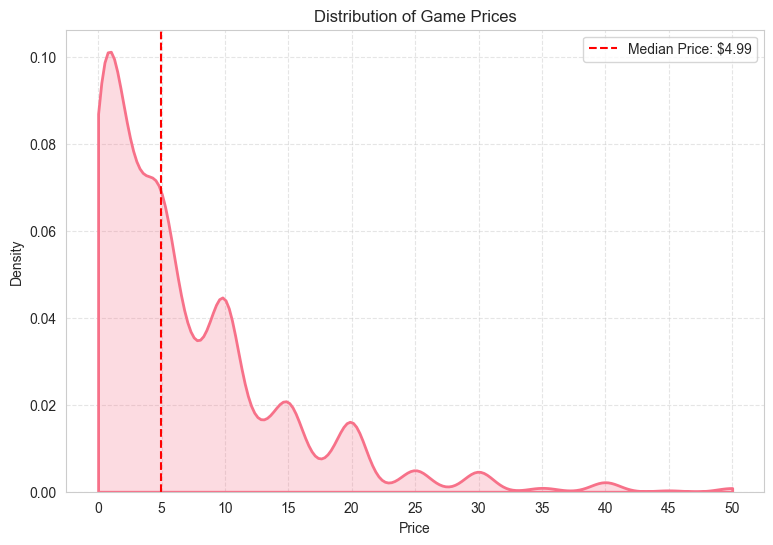
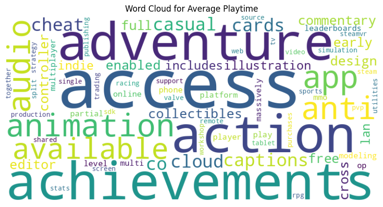
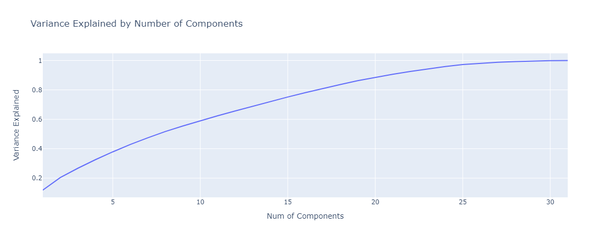
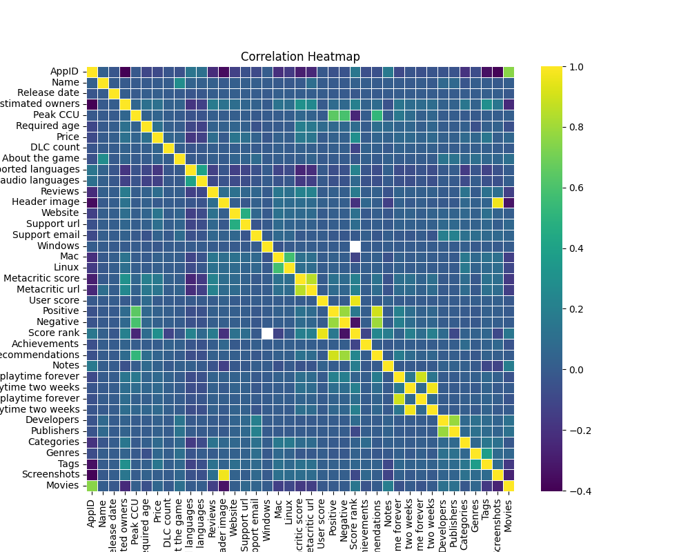
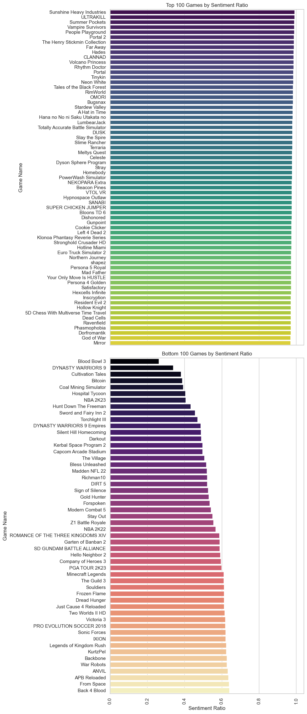

## The question

This project identifies the **key performance indicators** in a games app-store dataset and builds a **predictive model for game prices**. The goal is insight for the business teams responsible for decisions, with techniques that apply to any marketing dataset.

## The chapters

1. User sentiment analysis
2. Most popular platform metric
3. Language support metric
4. User engagement: playtime
5. NLP for gaming categories
6. Monetisation analysis: distribution of game prices
7. Monetisation analysis: price and engagement metrics
8. Monetisation analysis: DLC count and user engagement
9. Isolation Forest for outlier detection
10. Traditional A/B testing
11. Dimensionality reduction
12. Predictive modelling
13. Containerisation

## Methods

- Interactive dashboards with Plotly
- Regression with an **Extra Trees** regressor
- **Natural language processing** on game descriptions
- **Isolation Forest** outlier detection
- **Shapiro-Wilk** normality testing and the **Mann-Whitney U** test for A/B comparisons
- **Principal component analysis**

## Figures

<table>
<tr><td width="50%" valign="top"> Distribution of game prices</td><td width="50%" valign="top"> DLC count vs positive comments, coloured by estimated owners</td></tr>
<tr><td width="50%" valign="top"> Word cloud of categories for average playtime</td><td width="50%" valign="top"> Variance explained by number of principal components</td></tr>
<tr><td width="50%" valign="top"> Correlation heatmap</td><td width="50%" valign="top"> Sentiment ratio per game</td></tr>
</table>

## Run it

1. Download `requirements.txt`.
2. Follow the instructions in [`Conda_Virtual_Env.txt`](Conda_Virtual_Env.txt).

`requirements.txt` is a full freeze of the original environment, and some entries point to local conda builds. If pip cannot resolve them, install the packages listed under *Built with* below.

A [`Dockerfile`](docker/Dockerfile) is included for running the project in a container.

## Built with

`Python` · `NumPy` · `pandas` · `Matplotlib` · `Seaborn` · `SciPy` · `Plotly` · `scikit-learn` · `Joblib` · `WordCloud` · `LabelEncoder` · `PCA` · `delayed functions` · `itertools` · `Pingouin` · `PyCaret`

 

<a href="https://github.com/johnnyk1090">← back to the profile</a>

